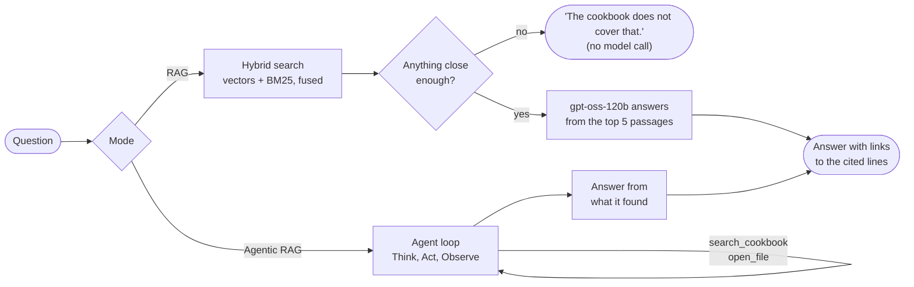

---
# the Hugging Face Space's settings (https://huggingface.co/docs/hub/spaces-config-reference); GitHub shows them
# as a table. sdk_version must match gradio in requirements.txt. Python 3.12: the Space runs on ZeroGPU, which
# takes only 3.12 or 3.10
title: Ask the Cookbook
emoji: 🍳
colorFrom: indigo
colorTo: gray
sdk: gradio
sdk_version: 6.30.0
python_version: "3.12"
app_file: app.py
pinned: false
license: mit
short_description: Questions on agentic-forge-cookbook, answered with sources
---

# Ask the Cookbook

**A chat assistant that answers questions about the
[Agentic Forge cookbook](https://github.com/Venkatdatta2402/agentic-forge-cookbook) and links every claim to the
exact lines it came from.**

[](https://huggingface.co/spaces/Venkatdatta/ask-the-cookbook)
[](LICENSE)


Agentic Forge is a cookbook that builds AI agents from first principles: an agent loop, tools, memory, context
engineering and multi-agent orchestration, written from scratch, then compared with LangGraph, CrewAI, AutoGen,
LlamaIndex and others. This assistant answers questions about it, and its agentic mode runs on **the cookbook's
own agent runtime**. The project asks the cookbook questions with the agent the cookbook teaches you to build.

**Try it:** [huggingface.co/spaces/Venkatdatta/ask-the-cookbook](https://huggingface.co/spaces/Venkatdatta/ask-the-cookbook)

---

## Contents

- [What it does](#what-it-does)
- [How it works](#how-it-works)
- [Designed for a free tier](#designed-for-a-free-tier)
- [Measured results](#measured-results)
- [Getting started](#getting-started)
- [Project structure](#project-structure)
- [Keeping the index current](#keeping-the-index-current)
- [Deployment](#deployment)
- [Limitations](#limitations)
- [Where the code comes from](#where-the-code-comes-from)
- [License](#license)

---

## What it does

You ask a question, and you pick how it is answered:

| | **RAG** | **Agentic RAG** |
|---|---|---|
| How | One hybrid search, then one model call that answers from the best 5 passages | An agent that searches and opens files as many times as the question needs (up to 8 tool calls) |
| Best for | A question about one idea or one chapter | A question that spans chapters, or compares two parts |
| Time | A few seconds | A few minutes |
| Cost | About 4,000 tokens | About 15,000 to 40,000 tokens |
| Key | The demo's shared key, or your own | Your own [Groq API key](https://console.groq.com/keys) (free) |

Both modes use `openai/gpt-oss-120b` on Groq. Answers come with **citations that open the cited lines on
GitHub**, and a list of sources named by file, lines and section.

It's also a **chat**:

- **Ask about.** Select any part of an answer, and an *Ask about* button appears beside it. The passage goes
  into your next question, so the model is sure to see the part you mean.
- **Token meter.** Shows how many tokens the chat holds, next to the 5,000 that one agent call can carry.
- **Compact now.** Replaces older turns with a summary and the facts pulled out of them, and keeps the last three
  exchanges word for word.
- **Nothing stored.** The chat lasts for your browser session. Your key is used for your questions only.

## How it works



### 1. The index

The corpus is what a reader of the cookbook would read: the root and chapter READMEs, the **prose** of every
notebook (markdown cells only, not code or outputs), and every Python module. Tests, stubs and the evaluation
chapters' answer keys are left out, so the assistant can't read off the answers it's graded on. That comes to 124
files and 1,015 chunks.

- **Prose** is split along its markdown headings, then into chunks of up to 800 tokens.
- **Code** is split by its syntax tree into chunks of up to 80 lines, so a function stays in one piece.
- Every chunk keeps its file and its line numbers. That's what lets an answer link to the exact lines.
- Chunks are embedded with Gemini `gemini-embedding-001` (768 dimensions) and stored as a LlamaIndex index.

### 2. RAG: hybrid search with a refusal floor

- **Two searches.** Vector search finds passages that mean the same thing as the question. BM25 keyword search
  finds exact names, like `_doom_loop` or `max_tool_calls`, that embeddings tend to blur.
- **Fused.** The two lists (10 passages each) are merged by reciprocal rank fusion, and the top 5 are kept.
- **Refusal floor.** If no passage scores at least **0.66** on raw vector similarity, the question is turned away
  before any model call. The floor was measured: the lowest-scoring answerable test question scored 0.702, the
  highest off-topic one 0.624. It's applied *before* fusion, because after fusion a score only reflects rank.
- **Citations.** The model cites passages by number, in several formats (`[1]`, `[Source 1]`, `【1†L9-L15】`).
  All of them are turned into one clickable `[n]` per source, pointing at the passage's lines on GitHub.
  Duplicate sources are merged, and code such as `pairs[2]` is never mistaken for a citation.

### 3. Agentic RAG: the cookbook's own agent

The agent is assembled from the cookbook's chapters 1 to 6, not from a framework:

- **The loop** (chapter 2) decides, acts and observes. Its two tools are `search_cookbook` (the same hybrid
  search, with no floor, returning passages labelled with file and lines) and `open_file` (reads up to 100 lines
  of a file the search pointed to).
- **The context system** (chapter 5) builds each model call. It pins the instructions and the question, always
  keeps the two newest items, and fills the rest of a **5,000-token budget** by relevance, kind and recency.
  Results that don't fit drop to one-line labels.
- **A ledger of calls made** is pinned into every call: each search and file read so far, and what it returned.
  This stops the agent redoing work it no longer has in view.
- **Repeat guards** refuse an exact repeat, and a near-duplicate search (the same words reordered or
  re-inflected), naming the earlier search.
- **A forced finish.** After 8 tool calls the agent must answer from what it found. That final call gets a
  7,000-token budget, enough for nearly everything the run read.
- **Isolation.** Each run gets its own model client on the visitor's key, so runs on different keys proceed at
  the same time without touching each other.

### 4. The chat

The chat keeps each question and final answer; the agent's tool calls are discarded once it answers. A RAG
answer is kept with its `[n]` citations rewritten as `[file, lines a-b]`, so a later agentic turn can open
exactly those lines. Compaction uses chapter 5's compressor, and is undone if the result wouldn't be smaller.

## Designed for a free tier

Every number above comes from a limit of Groq's free tier for `gpt-oss-120b`:

| Limit | What it shaped |
|---|---|
| A request over **8,000 tokens** is refused | Each agent call carries at most 5,000 tokens of context, which leaves room for the tool schemas, the instructions and the model's reply |
| **8,000 tokens a minute** | Agentic RAG takes minutes: each step waits for the minute's budget |
| **200,000 tokens a day**, per account | The demo key covers about 50 RAG questions a day for all visitors together. Agentic RAG runs on the visitor's own key |
| Free embeddings: 1,000 texts a day | The index is refreshed incrementally: only new or changed files are embedded |

When Groq refuses the demo key, the visitor is told which limit was hit. For the daily limit, they're asked to
paste their own key or come back tomorrow. For the per-minute limit, they're asked to try again in a minute.

## Measured results

From live runs against the real models:

| Run | Tokens | Time | Notes |
|---|---|---|---|
| RAG question | 4,027 | 3.9 s | Cited `runtime.py` lines 181-218: the exact function |
| Ask about a passage | 4,048 | 2.9 s | Found the exact code the selection referred to |
| Agentic RAG, multi-part question, before fixes | 39,174 | minutes | 8 tool calls, two searches nearly identical, one part never searched |
| The same question, after the ledger and guards | **14,503** | minutes | **4 tool calls**, every part answered correctly |
| Compact now | 1,941 | 17.6 s | Two model calls: a summary and the facts |

## Getting started

**Requirements:** Python 3.12, a [Groq API key](https://console.groq.com/keys) and a
[Gemini API key](https://aistudio.google.com/apikey). Both are free.

```bash
conda env create -f environment.yml        # or: pip install -r requirements-dev.txt
conda activate ask-the-cookbook
cp .env.example .env                       # then fill in the two keys
python app.py                              # http://127.0.0.1:7860
```

| Variable | Used for |
|---|---|
| `GROQ_API_KEY` | The demo key: RAG questions from visitors who haven't pasted their own |
| `GEMINI_API_KEY` | Embedding each question to search the index (and embedding the cookbook on a refresh) |

**Tests** run offline, with stand-in models and fake clients: no keys, no tokens.

```bash
pytest
```

They cover what's checked before any model call, citation parsing and linking, the agent's context budget and
guards, concurrent runs on different keys, compaction, and the index refresh.

## Project structure

```
app.py                     the Gradio app: the page, the two modes, citations, the waiting message
ask_the_cookbook/
    corpus.py              which cookbook files are read, and how (notebooks as their prose)
    search.py              the index, hybrid search with the refusal floor, the RAG engine, the agent's tools
    agent.py               the agent: the cookbook's loop and context system over those tools
    session.py             a visitor's chat: history, Ask about, the meter, compaction
    refresh.py             brings the index up to date with the cookbook's latest commit
    runtime/               the agent's parts, from the cookbook's chapters 1-6
data/
    index/                 the saved LlamaIndex index (the vector store is in Git LFS)
    corpus/                the cookbook's text exactly as indexed; answers link to these lines
tests/                     offline tests
.github/workflows/         the sync to the Space, and the index refresh
```

## Keeping the index current

<!-- index-commit -->
Built from the cookbook at commit [`fb39ada`](https://github.com/Venkatdatta2402/agentic-forge-cookbook/tree/fb39adac66b77dcd2a6ed4f17300e6b415632b63): 124 files, 1,015 chunks.
<!-- /index-commit -->

```bash
python -m ask_the_cookbook.refresh --dry-run    # what would change, and how many embeddings it would cost
python -m ask_the_cookbook.refresh              # do it
```

The refresh checks the cookbook's latest commit and stops if it's already indexed. Otherwise it fetches that
commit and compares it with the index **file by file, by content hash**, not by git diff. A git diff would flag
changes the index never sees, such as edits to notebook code cells. It then embeds only new or changed files,
removes deleted ones, and rewrites `data/corpus` and the line above. A run that would need more than 900
embeddings is refused, to stay inside the free daily quota.

The **Refresh the index** workflow runs the same module on GitHub from a button in the Actions tab. It commits
the result and copies it to the Space.

## Deployment

The app runs on [Hugging Face Spaces](https://huggingface.co/spaces/Venkatdatta/ask-the-cookbook). GitHub is the
source of truth: on every push to `main`, the **Sync to the Space** workflow uploads the repo to the Space with
Hugging Face's [`hub-sync`](https://github.com/huggingface/hub-sync) action, and the Space rebuilds.

| Where | Setting |
|---|---|
| Space secrets | `GROQ_API_KEY`, `GEMINI_API_KEY` |
| GitHub Actions secret | `HF_TOKEN`: a Hugging Face token with write access to the Space |
| GitHub Actions variable | `HF_SPACE`: `Venkatdatta/ask-the-cookbook` |

The Space runs on ZeroGPU, the hardware a free account gets for Gradio apps. The app needs no GPU, since its
models run on Groq and Gemini.

## Limitations

- **The refusal floor has a thin margin** (0.702 vs 0.624). An unusual phrasing of an answerable question can be
  turned away; naming the chapter or idea usually fixes it. Re-measure it if the corpus or embedding model changes.
- **Notebook citations open the notebook at the top.** GitHub shows notebooks in a frame that no link can scroll,
  so they're named by section instead of linked to lines.
- **One model.** The agent's prompts and tool format were tuned on `gpt-oss-120b`. Another model would need
  testing first: other model families format tool calls differently.
- **Free-tier limits.** The demo key's daily allowance is shared by every visitor, and agentic answers take
  minutes.
- **The index is refreshed by hand**, so it can trail the cookbook until the workflow is run.

## Where the code comes from

The assistant was first built inside the cookbook, in `08_frameworks/05_llamaindex`, and moved here at commit
[`fb39ada`](https://github.com/Venkatdatta2402/agentic-forge-cookbook/tree/fb39ada) as a package:

| Here | In the cookbook |
|---|---|
| `ask_the_cookbook/corpus.py` | `08_frameworks/05_llamaindex/cookbook.py` |
| `ask_the_cookbook/search.py` | `08_frameworks/05_llamaindex/ask_index.py` |
| `ask_the_cookbook/agent.py` | `08_frameworks/05_llamaindex/agent_scratch.py` |
| `ask_the_cookbook/runtime/` | `01_foundations` (llm, chat), `02_agent_runtime` (think, act, observe, runtime), `03_tools` (tools, registry), `04_memory/recall.py`, `05_context` (context, selection, focus, compression, system), `06_orchestration/supervisor.py` |

What changed:

- **Trimmed to what the app can reach.** Code that nothing in the app or the refresh can call was removed: the
  other reasoning strategies, the `Loop` and `Graph` runners, the supervisor agents, memory retrieval, the
  LlamaIndex agent and the evaluation helpers. What remains keeps its code and its teaching comments.
- **Per-run model clients.** An agent run can be given its own client, and every model call it makes goes
  through it, including the repair of a failed tool call and compaction. Given none, the code behaves as in the
  cookbook.
- **Built for the app:** the chat, the ledger of calls made, the near-duplicate guard and the larger final-answer
  budget.

## License

[MIT](LICENSE). The indexed text in `data/corpus/` is from
[agentic-forge-cookbook](https://github.com/Venkatdatta2402/agentic-forge-cookbook), by the same author.
